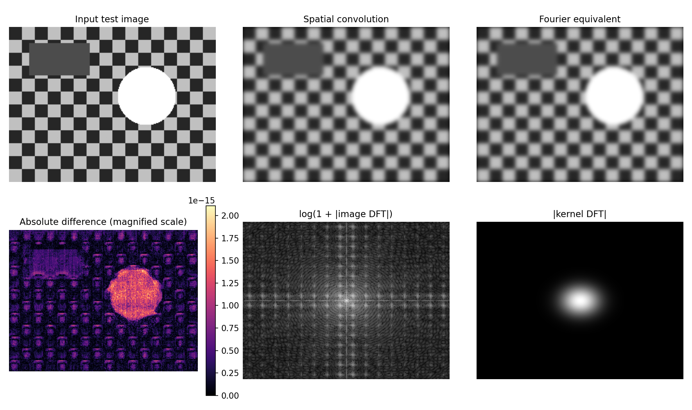

# Module 3: Image blurring and the convolution theorem

**Aya Abdelkarem — CSc 8830, Computer Vision — Spring 2026**

This project implements Gaussian image blurring in the spatial and Fourier domains, compares the complete numerical outputs, and explains why convolution in space equals multiplication in frequency.

## Deliverables

- [PDF report](Module_3_Report.pdf): methods, convolution-theorem derivation, typed worked example, figures, validation, and this repository's link.
- [Working demonstration video](Module_3_Working_Demo.mp4): 66 seconds, 1280 × 720, captioned actual application outputs.
- [Source code](module3.py) and [recording program](record_demo.py).
- [Numerical results](metrics.json), [exact arrays](convolution_arrays.npz), and [recording validation](DEMO_RECORDING_VALIDATION.json).

The PDF and video are prepared for manual attachment to the Week 3 / Module 3 assignment. **Nothing has been turned in to Google Classroom by these scripts.**

## Reproduce

Use Python 3.9 or later. Download this repository with **Code → Download ZIP**, extract it, and open a terminal in the extracted directory. All project files are in the root directory.

```bash
python -m pip install -r requirements.txt
python module3.py
python record_demo.py
```

To see the same working application window while it records:

```bash
python record_demo.py --show
```

Press Escape to stop the displayed run. The PDF, plots, arrays, metrics, and MP4 are regenerated by these commands. The recording reruns the experiment and verifies that its results match `metrics.json`. No camera, network connection, paid service, or external dataset is needed after package installation.

Optional image and filter settings:

```bash
python module3.py --image input_test_image.png --kernel-size 9 --sigma 1.5 --out custom_results
```

Use `--out` for custom runs so the default report and metrics stay paired with the default video. The supplied PNG is an 8-bit preview; the default experiment generates its exact float64 input directly. Use `convolution_arrays.npz` for the exact computed arrays.

## Method and executed result

The input is a deterministic **192 × 256 mathematical test image**, not a camera photograph. It includes repeated texture, a disk, and sharp edges. The **15 × 15 Gaussian kernel**, sigma **2.5 pixels**, is normalized to sum to one.

1. Compute full linear spatial convolution using `scipy.signal.convolve2d`, with zero extension beyond the image.
2. Zero-pad the image and the same kernel to **206 × 270**. Compute their FFTs, multiply point by point, and inverse transform.
3. Compare every full-output pixel before clipping or rounding. Use the identical centered crop only for image display.

| Quantity | Executed value |
|---|---:|
| Maximum absolute spatial/FFT difference | 2.1094237467877974e-15 |
| Root mean squared difference | 4.499848693526612e-16 |
| Largest imaginary inverse-FFT remainder | 2.193311057787751e-16 |
| Circular versus zero-boundary maximum difference | 0.39186342950931324 |
| Numerical checks passed | 8 of 8 |

The two linear-convolution methods agree to floating-point round-off. Minor round-off differences can vary across platforms. The circular-convolution counterexample uses a consistently centered kernel and independently matches SciPy's `boundary='wrap'`; its edge differences illustrate why padding and boundary conventions matter.



The absolute-difference panel uses a magnified color scale around 1e-15. The input and blurred outputs all share the same [0,1] display range. Spectrum shifts are used only for visualization, not in the convolution computation.

## Validation

The code checks full-output equivalence, crop alignment, an asymmetric kernel (to detect convolution/correlation flips), impulse alignment, conservation of the full-output sum, an independent explicit-DFT worked example, the circular-boundary reference, and interior agreement between boundary models. The small example is also fully typed in the PDF and stored in `tiny_example.json`.

`TESTED_ENVIRONMENT.json` records numerical-library versions. `DEMO_RECORDING_VALIDATION.json` records OpenCV, recording stages, source hashes, and decoding of all 1,320 video frames. Runtime samples are included for traceability and are **not** a benchmark. `FILE_SHA256.json` describes this published snapshot; regenerating files changes some hashes and timestamps.

## Recording and assistance disclosure

The MP4 records the application's rendered outputs from a **fresh actual computation**, with timed holds and captions. It is not an operating-system desktop screen capture and has no audio or claimed student narration. `--show` displays those same frames as the experiment runs. The test input is generated mathematically; no physical capture is claimed.

Review the implementation and results. Aya should review the code and derivation and be able to explain the results. The repository provides the source and exact outputs for that review.

## References

- [Module 3 assignment](https://docs.google.com/document/d/1KQo_l3bnipHFNhmJOHwoMuEz9xKV-I1FBO1RP9MCWVA/edit)
- [SciPy convolve2d](https://docs.scipy.org/doc/scipy/reference/generated/scipy.signal.convolve2d.html)
- [NumPy fft2](https://numpy.org/doc/stable/reference/generated/numpy.fft.fft2.html) and [ifft2](https://numpy.org/doc/stable/reference/generated/numpy.fft.ifft2.html)
